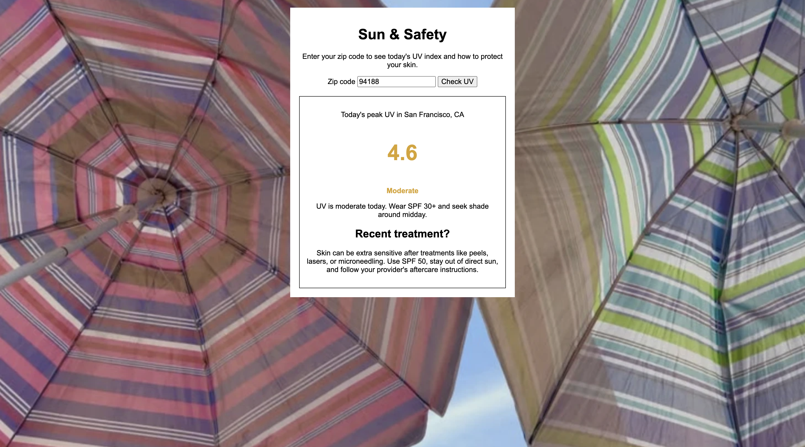

# Sun & Safety ☀️

A small page where you enter your zip code to see today's UV index and get sun safety and aftercare tips.

## Description

This is a project I built to practice using more than one API in a row. You type in a 5-digit zip code, and the page looks up where that zip code is, then asks a weather service for today's peak UV index at that spot. It shows the number, the UV level (from Low to Extreme), and advice on what SPF to wear. Because it's made for a med spa, it also shows an aftercare tip for people who recently had a treatment like a peel, laser, or microneedling. It uses plain HTML, CSS, and JavaScript, so there is no server to run.

## Screenshot

## Features

- Enter a US zip code to see today's peak UV index for that place
- Shows the place name, like "City, ST", so you know it found the right spot
- Five UV levels with their own color and advice: Low, Moderate, High, Very High, and Extreme
- Tells you which SPF to wear and when to avoid the sun
- An aftercare tip for recent treatments, which gets stricter when the UV is 3 or higher
- Friendly messages if the zip code isn't 5 digits, isn't found, or something goes wrong
- Beach umbrella background photo

## Tech Used

- HTML
- CSS
- JavaScript
- `fetch` and promises (`.then()` and `.catch()`)
- [Zippopotam.us](https://www.zippopotam.us/) (turns a zip code into a place and its location)
- [Open-Meteo](https://open-meteo.com/) (today's peak UV index)

## How to Use

1. Download or clone the project.
2. Open the app in your browser
3. Type a 5-digit zip code.
4. Click **Check UV**.
5. Read the UV level, the advice, and the aftercare tip.

## How It Works

1. When you submit the form, `main.js` checks that the zip code is 5 numbers.
2. It uses `fetch` to ask Zippopotam.us for the place name and the latitude and longitude of that zip code.
3. It sends that latitude and longitude to Open-Meteo and asks for today's highest UV index.
4. It compares the number to a list of UV levels to pick the name, color, and advice.
5. It shows the result on the page, and picks a stronger aftercare tip if the UV is 3 or higher.

## What I Learned

- How to use `fetch` and `.then()` calls so the second API uses the answer from the first
- How to get two API's to work together 
- How to use an array of objects to turn a number into a level, a color, and a message
- How to show and hide parts of the page with a CSS class

VIEW APP HERE: https://med-spa-mv2n.onrender.com/

## Author

Maya Rose 🌹
